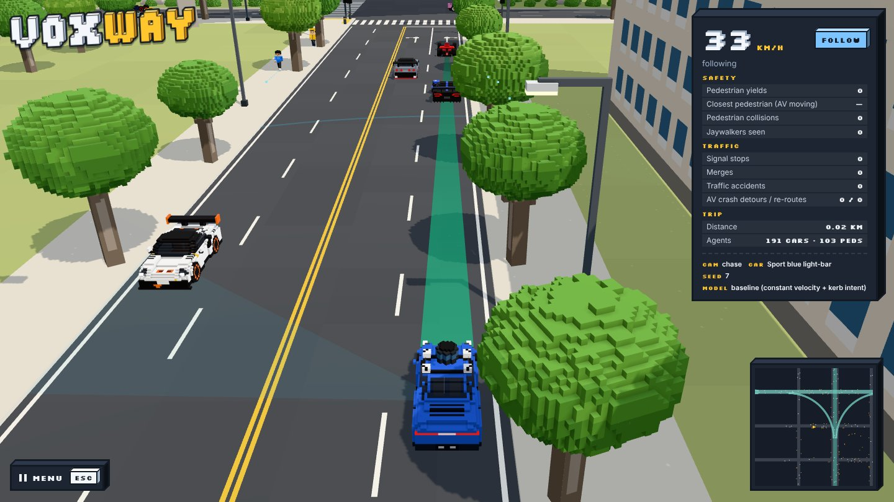
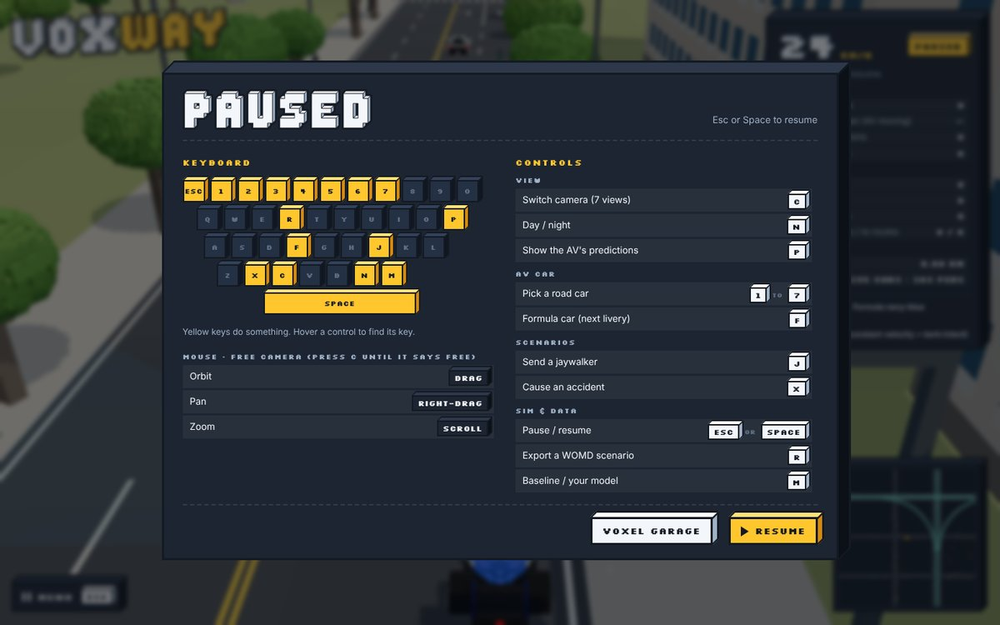
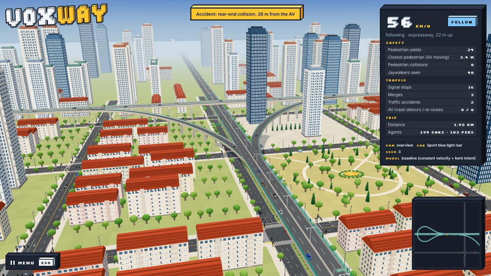
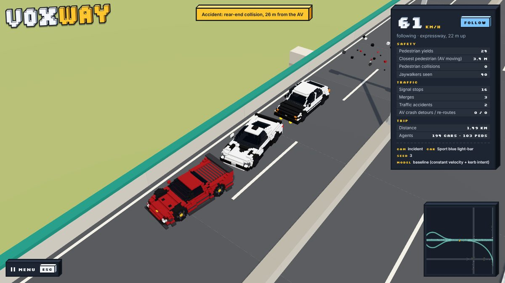
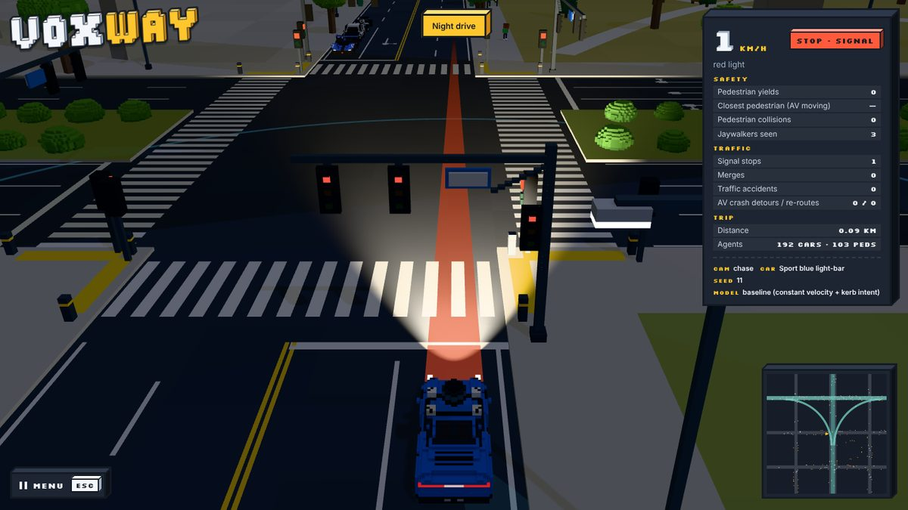

<p align="center">
  
</p>

<p align="center">
  <b>A self-driving car simulator in a voxel city.</b><br>
  The AV yields to hopping pedestrians, merges onto a two-level expressway and steers around crashes,<br>
  and you can train its pedestrian predictor on data the simulator makes for you.
</p>

<p align="center">
  
  
  
  <a href="#license"></a>
</p>

<p align="center">
  <a href="#quick-start">Quick start</a> ·
  <a href="#controls">Controls</a> ·
  <a href="#url-options">URL options</a> ·
  <a href="#whats-in-the-world">The world</a> ·
  <a href="#train-your-own-pedestrian-predictor">Train a predictor</a> ·
  <a href="#waymo-open-motion-compatibility">WOMD export</a> ·
  <a href="#voxel-assets">Voxel assets</a>
</p>



**Crossy Road, flipped.** In VOXWAY your self-driving car is the one in traffic, and the voxel pedestrians hopping across the road are the problem it has to solve. The AV drives a 3 km loop through a busy city and over a two-level expressway. It gives way at left turns, merges, stops for jaywalkers and gets around accidents, and it shows its reasoning as it goes.

Under the toy look is a real AV problem, **predicting pedestrians**, and a full pipeline for working on it: export labelled data from the simulator, train a model in PyTorch, then let the AV drive with it and measure whether it drives better.

## Highlights

- **A busy city.** About 190 cars and 100 pedestrians on a six-lane boulevard, side streets and two expressway levels, joined by curved ramps and linked to the streets by loop ramps.
- **Junctions that work like real ones.** 4-phase signals with protected-permissive left turns, zipper merges, and drivers who don't block the box.
- **Pedestrians that are hard to predict.** Some wait for the green man. "Hoppers" cross in Crossy Road-style hops, freeze mid-road or jaywalk.
- **Things go wrong.** Drivers get distracted, run red lights, cut in and speed. Crashes use impulse physics and leave wrecks that block lanes, and road works close a lane.
- **An AV that shows its thinking.** Its planned path, its pedestrian forecasts and the reason for every decision are drawn in the scene and on the HUD.
- **A full ML loop on a laptop.** Export data headlessly, train a 6-mode trajectory model in PyTorch and drive with it in the browser, which needs no ML library.
- **Waymo Open Motion format.** One key exports the last 9.1 s as a WOMD-style scenario JSON, with accident labels.
- **MagicaVoxel all the way down.** Every model is a `.vox` file, meshed in the browser with baked ambient occlusion. Edit one in MagicaVoxel, save and refresh.
- **Reproducible.** A fixed 60 Hz step and one seeded random stream, so `?seed=42` replays the same run.

## Quick start

You need [Node.js](https://nodejs.org) 20.19+ or 22.12+ and a browser with WebGL 2 (any recent Chrome, Edge, Firefox or Safari). A desktop browser works best, since the controls use the keyboard.

```bash
git clone https://github.com/arifidris1103/voxel-av-sim.git
cd voxel-av-sim
npm install
npm run dev
```

Then open **http://localhost:5173**. Press **Esc** at any time for the pause menu, which lists every control. The **Voxel Garage** at http://localhost:5173/garage.html (also linked from the pause menu) shows every model up close.

Python is only needed for the extras:

| To | You need |
| --- | --- |
| Regenerate the voxel assets | Python 3 with NumPy |
| Train a pedestrian predictor | Python 3, NumPy and PyTorch 2.1+ (`pip install -r ml/requirements.txt`) |

## Controls

| Key | What it does |
| --- | --- |
| <kbd>C</kbd> | Switch camera: chase → Crossy-style iso → aerial overview → interchange → incident (the latest crash) → hood → free |
| <kbd>N</kbd> | Day / night |
| <kbd>P</kbd> | Show or hide the AV's predictions |
| <kbd>1</kbd>–<kbd>7</kbd> | Pick the AV's road car |
| <kbd>F</kbd> | Switch to a formula car (each press picks the next livery) |
| <kbd>J</kbd> | Send a jaywalker into the AV's path |
| <kbd>X</kbd> | Cause an accident ahead of the AV (on the expressway: a speeding driver) |
| <kbd>Esc</kbd> or <kbd>Space</kbd> | Pause and open the menu, or resume |
| <kbd>R</kbd> | Export the last 9.1 s as a [WOMD-style scenario](#waymo-open-motion-compatibility) |
| <kbd>M</kbd> | Switch between the baseline predictor and your model (needs [`?model=`](#url-options)) |

In the free camera, drag to orbit, right-drag to pan and scroll to zoom.

<p align="center">
  
</p>

## URL options

Add these to the address, for example `http://localhost:5173/?seed=3&until=flyover&cam=overview`.

| Option | Default | What it does |
| --- | --- | --- |
| `seed=42` | random | Replays the same run: same traffic, pedestrians and accidents. The HUD shows each run's seed. |
| `cam=overview` | `chase` | Starting camera: `chase`, `iso`, `overview`, `interchange`, `incident`, `hood` or `free` |
| `car=3` | `7` | The AV's car: `1`–`7` are the road cars, `8`–`13` the formula cars |
| `night=1` | off | Start at night |
| `cars=90` | `76` | Cars on the streets |
| `hwy=40` | `28` | Cars on the lower viaduct |
| `fly=120` | `90` | Cars on the upper flyover and its ramps |
| `peds=120` | `90` | Pedestrians |
| `crashes=2` | `0.8` | Accidents per minute; `0` turns them off |
| `warm=20` | `0` | Simulate 20 s before showing anything |
| `until=flyover` | | Fast-forward until the AV reaches `loop` (the west loop ramp), `flyover` or `loopE` (the east loop ramp). `then=5` runs 5 s more. |
| `crash=speeding` | | Start just after an accident near the AV: `distracted`, `red_light`, `unsafe_lane_change` or `speeding`. `after=5` starts 5 s after it (the default is 2). |
| `model=models/ped_mlp.json` | | Drive with a trained pedestrian predictor ([see below](#train-your-own-pedestrian-predictor)) |

A few to try:

- `?seed=3&until=flyover&cam=overview`: the whole interchange from above
- `?until=flyover&crash=speeding&cam=incident`: a crash on the flyover, with the AV working its way around it
- `?night=1&cam=iso`: a night drive from the Crossy Road angle
- `?crashes=0&peds=150`: no accidents and more pedestrians, to watch the AV yield

## What's in the world

### The city

The map is a voxel take on a Shanghai-style expressway interchange. A viaduct on hammerhead piers with teal parapets runs across the city, and a flyover about 22 m up crosses it, joined to it by two long curved ramps. Outside the city a loop ramp at each end links the flyover with north_st, which carries on out of town underneath it. The ramps join like real ones: the deck widens into an exit or entry lane with a dashed edge line, a painted gore narrows to a nose, and only then does the ramp split off and climb or descend, at 7 % at most. Down below are a six-lane boulevard, red-roof housing, white residential towers, blue glass offices and a park with an oval flower bed.



### The AV's loop

The AV (any of the 13 cars, with a voxel lidar and camera kit on its roof) drives a loop of about 3 km:

- **City streets:** left turns on the arrow or through gaps in oncoming traffic, right turns across busy crosswalks, a road-works lane closure to merge around, and three passes under the viaduct.
- **Expressway:** out of town on north_st and up the west loop ramp, which climbs through the gap between the street and the flyover and merges into flyover traffic 22 m up. Then across the city past the curved-ramp junctions, down the east loop ramp and back into town.

If an accident blocks its way, it detours or re-plans its route and rejoins the loop.

### Traffic

- About 190 cars: 76 on the streets, 28 on the viaduct and 90 on the flyover and its ramps.
- Cars follow the car ahead with the Intelligent Driver Model (IDM) and change lanes when the gap is safe. On the expressway they overtake on the left and move back right afterwards.
- Signals run a 4-phase cycle: a through phase and a left-turn arrow for each direction, with walk signals alongside the through phases. Cars give way to pedestrians and don't block the box.
- **Left turns are protected-permissive, as in real life.** During the 5 s arrow the turn is protected. On the plain green a left-turner may still go, but it gives way: it turns only if it can clear the oncoming lanes, with a margin, before the next oncoming car arrives. The first car in line pulls into the junction to wait for a gap and finishes its turn when the light changes. A car that is already too close to stop short of another car's path keeps going, and the others wait for it. The AV follows the same rules with a bigger margin, and shows `GIVE WAY` while it waits.
- **Merges zip.** Where two lanes become one, each pair of cars agrees early on who goes first, and the other eases back in good time instead of braking at the join. Some drivers are courteous and let a waiting car in.

### Pedestrians

About 90 pedestrians walk a sidewalk graph, wait for the walk signal and cross at zebra crossings. They come in two styles:

- **Walkers** mostly behave, though some jaywalk mid-block.
- **Hoppers** cross in discrete, Crossy Road-style hops and sometimes freeze in the middle of the road. The pauses between hops fool any predictor that relies on velocity, which is what makes them hard.

A scenario director keeps sending jaywalkers into the AV's path. Road workers stand in the closed lane at the road works, and bystanders stop to watch when there's a crash.

### Accidents and road works

Drivers make the mistakes real drivers make, about 0.8 times a minute by default and more often near the AV's route:

- a distracted driver stops watching the car ahead (rear-end)
- a driver runs a red light (T-bone, or a near miss)
- a driver changes lanes into a car that's already there (sideswipe)
- on the expressway, a speeding driver goes 40–55 % over the limit: it tailgates and reacts late, squeezes into small gaps (some never check the blind spot), or takes a curved ramp far too fast and loses control into the parapet

Crashes use simple impulse physics, so the cars slide and spin, with flying debris, smoke, hazard lights and a warning triangle. Wrecks stay for about 40 s and block one or more lanes, and traffic changes lanes or takes another exit around them. A driver at fault still brakes hard for the AV, and every such case is logged as a near miss.

The road works close one lane with cones, and traffic merges out of it before the taper.

<table>
  <tr>
    <td width="50%"></td>
    <td width="50%"></td>
  </tr>
  <tr>
    <td align="center">A rear-end crash on the flyover (incident camera)</td>
    <td align="center">Night drive: the AV stops for a red light</td>
  </tr>
</table>

### What the AV shows you

In the scene:

- its planned path: green = go, amber = caution (merging or giving way), red = yield or stop
- its pedestrian forecasts as dashed lines: cyan = walking on, amber = may cross, red = conflicts with the AV
- a ring around the pedestrian it's yielding to, and a lidar sweep

On the HUD:

- its speed and decision (`CRUISE`, `FOLLOW`, `TURN`, `MERGE`, `CAUTION`, `GIVE WAY`, `YIELD`, `STOP · SIGNAL` or `AVOID · CRASH`), with the reason underneath
- the pedestrian it's yielding to, with the distance to the conflict, the probability and the time to collision
- safety counters (pedestrian yields, the closest pedestrian while moving, pedestrian collisions, jaywalkers seen), traffic counters (signal stops, merges, accidents, crash detours and re-routes) and the trip so far
- the camera, car, seed and predictor in use, and a minimap that also shows the expressways, the ramps and wrecks

## Train your own pedestrian predictor

The whole loop runs on a laptop: make data with the simulator, train in PyTorch, then let the AV drive with your model.

```bash
npm run dataset -- --seeds 1-8 --minutes 5   # ~220k labelled samples in data/peds
pip install -r ml/requirements.txt           # numpy and torch
python ml/train_ped_predictor.py             # writes public/models/ped_mlp.json
npm run evaluate -- --seeds 101-108          # closed-loop test on unseen seeds
```

Then open `http://localhost:5173/?model=models/ped_mlp.json` and press <kbd>M</kbd> to switch between the baseline and your model.

- **Headless.** `tools/headless` runs the same simulation code in plain Node, with no browser and no rendering. Each seed runs in its own process at about 6× real time, up to 4 at once by default (`--jobs N` changes that; each process takes about 300 MB).
- **The data** (`tools/headless/export-dataset.mjs`). Once a second, every pedestrian on the streets becomes a sample with:
  - 78 inputs from `src/sim/PedFeatures.js`: 1.1 s of motion at 10 Hz, the nearest kerbs, the crosswalk and its walk light, and the 4 nearest cars, all in the pedestrian's own frame
  - where it really went over the next 4 s
  - the baseline's guesses, for comparison
  - labels a real AV couldn't see: walker or hopper, its state (such as `jaywait`, about to jaywalk) and whether it steps into the road

  The arrays are saved as `.npy` files, and `info.json` lists the columns. `--womd 30` also saves a full WOMD-style scene every 30 s.
- **The model** (`ml/train_ped_predictor.py`). An MLP predicts 6 possible 4-second paths with a probability each, trained winner-takes-all. Pedestrians on the road, at a crossing or about to step out count 5× in the loss (`--focus 4`), because they're rare and they're the ones that matter. It's validated on seeds it never saw and compared with the baseline on the same pedestrians, overall and for the hard cases: hoppers, people waiting at a crossing, about to jaywalk, jaywalking and stepping into the road. The weights are exported as JSON and run in plain JavaScript (`src/sim/LearnedPredictor.js`), so the browser needs no ML library and the build still works on a static host.
- **Closed loop** (`tools/headless/evaluate.mjs`). Offline scores say how well a model guesses; this says whether the AV drives better with it. It reports pedestrian collisions, close calls, time spent yielding, hard braking and average speed for the baseline and your model on the same seeds.
- **Changing the inputs.** Edit `PedFeatures.js`, bump `FEATURE_VERSION`, export the data again and retrain. The simulator refuses a model trained on different inputs.

Ideas to try: a GRU or Transformer over the history, the AV's planned path as an input, more neighbouring cars, a different `--focus`, or pretraining on real WOMD pedestrians. Watch the closed-loop numbers as well as the offline ones: a model that's more accurate on average can still react later to the rare jaywalker.

## Bring your own predictor

Any function can drive the AV's pedestrian forecasts. Swap one in from the browser console or your own script:

```js
sim.setPredictor((agents) =>
  // agents: the pedestrians within 55 m of the AV, on its level
  //   [{ id, ped, history: [{ x, z, h }, ...] }]
  //   x east, z south (metres), h = heading; 10 Hz, oldest first, up to 11 samples
  agents.map((a) => [
    // one entry per guess: a probability, and world x/z points t seconds ahead
    {
      prob: 1.0,
      traj: [{ t: 0.5, x: a.ped.pos.x, z: a.ped.pos.z } /* , ... up to about 4 s */],
    },
  ]),
);
sim.setPredictor(null); // back to the baseline
```

The AV yields when a guess with a probability of 0.3 or more crosses its path at about the time it gets there (or the pedestrian is already in its path), and also when several less likely guesses that cross add up to 0.3. So a model that spreads its bets doesn't have to put 0.3 on any single one. Give the function a `modelName` property to show its name on the HUD.

The predictor runs every frame, so a model on a server should work asynchronously: return the latest cached result and refresh it in the background at about 10 Hz. Other calls on `window.sim`:

| Call | What it does |
| --- | --- |
| `sim.observation()` | The current frame in WOMD terms |
| `sim.exportScenario()` | The last 9.1 s as a WOMD-style scenario (the same as <kbd>R</kbd>) |
| `sim.advance(seconds)` | Step the simulation without rendering |
| `sim.crash(kind)` | Cause an accident ahead of the AV: `distracted`, `red_light`, `unsafe_lane_change`, `speeding`, or a random one |
| `sim.time`, `sim.seed` | Seconds simulated so far, and the run's seed |

The baseline (`src/sim/Predictor.js`) is deliberately simple: a constant-velocity guess, plus a "crossing" guess for pedestrians standing at a kerb facing the road, gated by the walk signal at signalised crossings. The pauses between hops fool its velocity estimate, which is exactly the gap a learned model should close.

## Waymo Open Motion compatibility

The world is built so a model trained on the [Waymo Open Motion Dataset](https://waymo.com/open/) (WOMD) can drive the AV's pedestrian forecasts, and so scenes from the simulator can go through the same preprocessing as WOMD:

- **Same sampling:** 10 Hz, with an 11-step (1.1 s) history.
- **Same map vocabulary:** lanes are polylines with entry and exit lanes and speed limits, crosswalks are polygons, and signals give per-lane states with stop points (`src/world/RoadNetwork.js`).
- **Same schema on export:** <kbd>R</kbd> or `sim.exportScenario()` writes a `Scenario` with WOMD's field names and enum values: `tracks[].states[]` (`center_x/y/z`, `length/width/height`, `heading`, `velocity_x/y`, `valid`), `object_type` (1 vehicle, 2 pedestrian), `sdc_track_index`, `tracks_to_predict`, `map_features` (`lane`, `crosswalk`) and `dynamic_map_states[].lane_states` (`LANE_STATE_*` values). It has 91 steps with `current_time_index = 10`. Coordinates follow WOMD (x east, y north, z up), so `y = -z` from the simulator's three.js frame.

WOMD has no accident labels, so they go in an extra `metadata.events` list, and cars involved in a collision are added to `tracks_to_predict` with `difficulty: 2`. Each event has a time within the window and the ids of the tracks involved.

<details>
<summary>Event types</summary>

- `distracted_driver`, `red_light_violation`, `unsafe_lane_change` and `speeding` (with `over_limit`)
- `collision`, with `kind` (`rear_end`, `t_bone`, `sideswipe`, `head_on`, `loss_of_control` or `chain`, worked out from the geometry of the impact), `cause` (the mistake behind it), `at_fault`, `rel_speed` and `elevated` (on the expressway)
- `near_miss` with the AV, and `cleared`

</details>

Pedestrian tracks also carry `sim_labels` (walker or hopper, and their state at each step), and `dynamic_map_states` includes the walk-light states. No Waymo data is included in this repository: the exporter only follows the dataset's format.

## Voxel assets

Every model lives in `public/assets/vox/` and is listed in `public/assets/manifest.json` with its voxel size, label and material tags.

| Folder | What's in it | Voxel size |
| --- | --- | --- |
| `cars/` | 7 road cars and 6 open-wheel formula cars in different liveries. Wheels are separate parts (`body` + `wheel_FL/FR/RL/RR`) so they spin and steer. | 0.075&nbsp;m |
| `npcs/` | 11 pedestrians: 6 made by hand (sources in `npcs/`) and 5 generated (courier, road worker, elder, jogger, kid) | 0.036&nbsp;m |
| `props/` | street lamps, signals, pedestrian signals, trees, cones, barriers, a gantry, viaduct, flyover and ramp piers, a warning triangle, a bus shelter, the AV's roof kit… | 0.04–0.3&nbsp;m |
| `buildings/` | red-roof housing, residential towers, glass offices and shop rows, stored as hollow shells | 0.5&nbsp;m |

- **Edit in MagicaVoxel.** Open any `.vox`, change it and save. The simulator and the garage load the files directly, so a browser refresh shows the change.
- **Inspect it in the garage.** `garage.html?asset=cars/retro_panda_coupe&view=both` shows a model from the front and the back. The other views are `front`, `rear`, `side`, `top` and `orbit`, and `&anim=walk` (or `run`, `hop`, `wait`) animates a pedestrian.
- **Regenerate.** Most assets come from Python scripts in `tools/voxgen/` (`cars.py`, `npcs.py`, `props.py`; NumPy only). `npm run assets` rebuilds them all, and `python3 tools/voxgen/build_all.py cars:retro_panda_coupe` rebuilds one.
- **Keep your edits.** Regenerating overwrites the file, so after hand-editing a generated model, add its name to `HAND_EDITED` in `tools/voxgen/build_all.py` (the panda coupe is already there). `npm run assets` then leaves it alone, and only naming it explicitly rebuilds it. If you change a car's size, update its `length` and `width` in `manifest.json`. Files in `npcs/` are only ever copied.
- **Conventions.** Z is up and models face −Y. Pedestrians have 10 parts (`head`, `body`, `arm_upper/lower_R/L`, `leg_upper/lower_R/L`), which `src/sim/NpcRig.js` turns into a jointed skeleton for walking, running, waiting and hopping.
- **Materials.** MagicaVoxel glass and emissive materials are honoured. Brake lights, headlights and signal lamps are palette indices tagged in the manifest (`brake`, `head`, `sig_red/yellow/green`, `ped_walk/stop`), so the simulator can switch them on and off.

## Project structure

```
index.html, garage.html     the simulator and the Voxel Garage
src/
  main.js                   app shell: cameras, keys, night mode, the window.sim API
  garage.js                 the Voxel Garage
  vox/                      .vox parser, greedy mesher with baked AO, instancing and LOD
  world/RoadNetwork.js      the map: lane graph, ramps, signals, crosswalks, sidewalks
  world/WorldBuilder.js     builds the city: roads, decks, ramps, props, buildings
  sim/Simulation.js         builds and steps the simulation (browser and headless)
  sim/Traffic.js            vehicles: IDM, signals, junctions, merges, lane changes
  sim/Pedestrians.js        walking, crossings, jaywalking, hopping, road workers
  sim/Incidents.js          driver mistakes, crash physics, wrecks, accident events
  sim/EgoPlanner.js         the AV: route, lanes, yielding, and what it draws
  sim/Predictor.js          10 Hz history and the baseline pedestrian predictor
  sim/PedFeatures.js        inputs for a learned predictor (export and browser)
  sim/LearnedPredictor.js   runs a model trained by ml/train_ped_predictor.py
  sim/Recorder.js           WOMD-style scenario export
  sim/Random.js             the seeded random stream behind ?seed=
  sim/NpcRig.js             jointed voxel pedestrians and their animations
  ui/Hud.js                 HUD and minimap
  ui/PauseMenu.js           pause menu and the list of controls
  ui/voxway.css             the VOXWAY look: voxel blocks, buttons, HUD and menu
  assets/                   logo, menu title and the Silkscreen font
public/assets/              the .vox models and manifest.json
tools/voxgen/               Python generators for the .vox files and the manifest
tools/headless/             the sim in plain Node: dataset export and evaluation
ml/                         PyTorch training for the pedestrian predictor
npcs/                       the hand-made pedestrian models
docs/images/                screenshots for this README
```

## How it works

- **Fixed step, smooth frames.** The simulation always steps at 1/60 s. Each frame draws the cars (and aims the camera) part of the way between their last two steps, so motion stays smooth at any frame rate.
- **Deterministic runs.** Everything random comes from one seeded stream, so a seed replays the same run until you press <kbd>J</kbd> or <kbd>X</kbd> or change the car. The headless tools are deterministic per seed too. Replays are exact within one JavaScript engine; Safari and Node round some maths slightly differently.
- **Voxels to meshes.** `.vox` files (versions 150 and 200, with the scene graph and MATL materials) are parsed and greedy-meshed in the browser with baked ambient occlusion, and an exterior flood fill drops hidden interiors. Repeated models are instanced, and the city is built in chunks with lower-detail (2× downsampled) meshes for the distance.
- **Junction logic.** Paths through a junction meet in conflict zones. A car that has to give way enters one only when it can clear it before the next car with priority arrives. Once a car can no longer stop short of another car's path it's committed, and the other one waits. At a merge, whichever car is ahead once they're side by side goes first.
- **One codebase, two runtimes.** `src/sim/Simulation.js` builds the same world in the browser and in Node. Headless runs read the `.vox` files straight from disk and skip rendering.

## Build and deploy

```bash
npm run build     # static site in dist/ (the simulator and the garage)
npm run preview   # serve dist/ locally to check it
```

The build uses relative paths (`base: './'` in `vite.config.js`), so `dist/` runs from any folder on any static host. To put it on GitHub Pages, set **Settings → Pages → Source** to **GitHub Actions** and add the workflow from [Vite's deployment guide](https://vite.dev/guide/static-deploy#github-pages). You can skip its step about `base`.

## Contributing

Issues and pull requests are welcome. If you report odd driving or pedestrian behaviour, include the seed from the HUD and roughly when it happened, so it can be replayed with `?seed=`.

## Credits

- **Car designs:** the seven road cars are voxel re-creations of renders by the voxel artist **@FENRATE**, and the credit for those designs is theirs. The real cars behind them belong to their manufacturers. The six formula cars are original.
- **Pedestrians:** the six hand-made pedestrians in `npcs/` were made in MagicaVoxel for this project. The other assets are generated by the scripts in `tools/voxgen/`.
- **Font:** [Silkscreen](https://github.com/googlefonts/silkscreen) by Jason Kottke, under the SIL Open Font License 1.1 (`src/assets/fonts/OFL.txt`).
- **Built with** [three.js](https://threejs.org) and [Vite](https://vite.dev). Training uses [PyTorch](https://pytorch.org) and [NumPy](https://numpy.org), and the models are made in [MagicaVoxel](https://ephtracy.github.io).
- **Inspired by** Crossy Road and the [Waymo Open Motion Dataset](https://waymo.com/open/).

VOXWAY is an independent project. It isn't affiliated with or endorsed by Waymo, Hipster Whale (the makers of Crossy Road) or MagicaVoxel.

## License

The code and the voxel assets are released under the [MIT License](LICENSE), except:

- the seven road-car models (everything in `public/assets/vox/cars/` except `formula_*`), which re-create @FENRATE's designs and aren't covered by the MIT License. Please don't reuse them without the artist's permission.
- the Silkscreen font, which stays under the SIL Open Font License 1.1.

<p align="center"><sub>Made by <a href="https://github.com/arifidris1103">@arifidris1103</a></sub></p>
